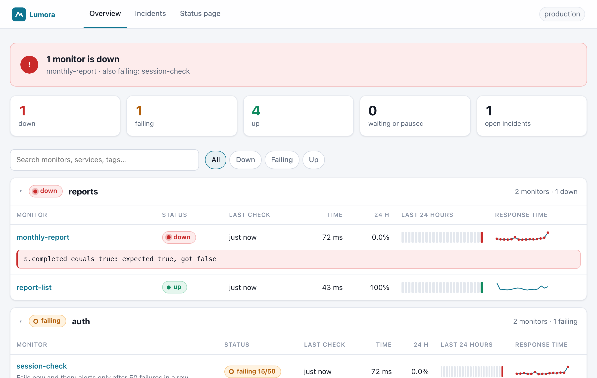

# api-qovrix

**Self-hosted API monitoring for any stack that catches breaking changes, not just downtime.**
Monitors live in Git and run the same in CI and production.

[](https://github.com/jsxd3v/api-qovrix/actions/workflows/ci.yml)
[](LICENSE)


Uptime tools tell you *whether* an API answers. api-qovrix also tells you whether it still answers
**the way your code expects**: a field renamed, a number that became a string, a value that is suddenly
`null`. Those changes return `200 OK`, so most monitors stay green while your clients break.

```text
$ api-qovrix run
shop-api
  ✔  list-orders     200   84 ms
  ✘  get-order       200   91 ms  → drift (breaking)
  get-order
    DRIFT (breaking)
      ✘ $.customer.email   string → null
      ✘ $.total            integer → string
      + $.total_cents      new field (integer)   info

1 passed, 1 failed · 0.3s · env production
```

## Works with any stack

api-qovrix only talks HTTP, so your API can be written in any language: JavaScript/TypeScript, PHP, Go,
Java, C#, Ruby or Python. Monitors are YAML files; **you don't need Python** unless you choose to install with pip.

| You use | Install |
|---|---|
| Any laptop (macOS, Linux) | `curl -fsSL https://github.com/jsxd3v/api-qovrix/releases/latest/download/install.sh \| sh` |
| Windows | Download `api-qovrix-windows-x64.exe` from [Releases](https://github.com/jsxd3v/api-qovrix/releases) |
| Docker | `docker run --rm -v "$PWD:/work" ghcr.io/jsxd3v/api-qovrix run` |
| GitHub Actions | `uses: jsxd3v/api-qovrix@v0` ([see below](#in-ci)) |
| Python | `pip install api-qovrix` |

## Quickstart

```bash
api-qovrix init            # creates api-qovrix.yaml and monitors/example.yaml
api-qovrix run             # runs every monitor once; exit code 1 if anything fails
api-qovrix serve           # keeps running: history, alerts and a dashboard at http://localhost:8080
```

Generate monitors from your OpenAPI spec (optional):

```bash
api-qovrix import openapi ./openapi.yaml
```

## What a monitor looks like

```yaml
# monitors/orders.yaml
monitors:
  - name: get-order
    request:
      method: GET
      url: /v1/orders/{{ vars.order_id }}
      auth: { type: bearer, token: "{{ secrets.API_TOKEN }}" }
    vars: { order_id: 1001 }
    assert:
      - status: 200
      - response_time_ms: { lt: 800 }
      - jsonpath: $.status
        in: [pending, paid, shipped]
    drift:
      enabled: true
      ignore: ["$.meta.request_id"]

  - name: checkout-flow
    steps:
      - name: login
        request: { method: POST, url: /v1/auth/token, json: { client_id: "{{ secrets.CLIENT_ID }}" } }
        extract: { token: $.access_token }
      - name: create-cart
        request:
          method: POST
          url: /v1/carts
          headers: { Authorization: "Bearer {{ steps.login.token }}" }
        extract: { cart_id: $.id }
        assert: [{ status: 201 }]
      - name: cleanup
        always_run: true
        request: { method: DELETE, url: "/v1/carts/{{ steps.create-cart.cart_id }}" }
```

Editors autocomplete these files from the published [JSON Schema](schema/).

## Two ways to run it

| | `api-qovrix run` (in CI) | `api-qovrix serve` (on a server) |
|---|---|---|
| What it does | Checks every monitor once and exits | Checks each monitor on its interval, around the clock |
| Where | GitHub Actions or any CI, cron, your laptop | Any VPS, VM, Docker host or Kubernetes, next to your app |
| Results | Terminal, exit code, JUnit, JSON, HTML report | History, dashboard and REST API at `:8080` |
| Alerts | `--notify`: one message per run when something fails | When a monitor goes down (after N failures) and when it recovers |
| Needs a server | No | Yes, a small one is enough |

Both use the same `api-qovrix.yaml` and monitor files. api-qovrix runs next to your app, never inside it, so
it works the same whether your API runs on a VPS, in containers or on a serverless platform.



## Features

**Catch breaking changes**

- **Contract drift detection.** api-qovrix learns the shape of each response and reports removed fields,
  type changes, new `null`s, unseen enum values and arrays that are suddenly empty, with a readable diff.
  New fields are `info`, optional fields are recognised, and volatile paths can be ignored, so it stays quiet
  when nothing important changed.
- **Baselines in Git, like snapshot tests.** Shapes are stored in `.api-qovrix/baselines/`, reviewed in pull
  requests, and updated with `--update-baselines` or `api-qovrix drift accept`. They hold types, presence
  counts and short one-way fingerprints of enum-like values, never the raw response values.
- **OpenAPI validation.** Every response is checked against your spec (3.0 and 3.1). `import openapi`
  generates monitors for safe (GET/HEAD) operations.

**Write checks**

- **Multi-step flows** with values passed between steps, cleanup steps that always run, and retries.
- **Auth:** bearer, basic, API key (header or query), OAuth2 client credentials, and a shared login
  (`token_request`) for any API that hands out a token: one sign-in, reused by every monitor until it expires.
- **Assertions:** status, response time, headers, body text, JSON Schema and JSONPath with `equals`, `in`,
  `contains`, `matches`, `gt`/`lt`, `length`, `type`, `exists`, `not_empty` and more.
- **Services:** monitors grouped per API, with shared base URL, auth, headers and status-page links.
- **Secrets stay secret:** only read from environment variables and masked in every report.

**Run and get told**

- **CI-ready:** exit codes, JUnit XML, JSON, a self-contained HTML report (`--html`), a GitHub Action, a
  Docker image and standalone binaries.
- **Continuous monitoring:** `serve` runs monitors on an interval or a cron schedule ("08:00 on weekdays"),
  keeps history in SQLite, alerts when a monitor goes down or recovers (grouped per service, with optional
  reminders) and reloads monitor files when they change.
- **Monitoring the monitor:** `/healthz` for outside uptime checks, and heartbeat pings so you're told if the
  monitoring server itself goes down.
- **Dashboard and REST API:** an at-a-glance banner, per-service sections with hourly uptime bars,
  "failing" vs "down", readable error boxes, search and filters, run details with drift diffs, incidents and
  "Run now". Password-protected, with no external scripts, and your own name, logo and color.
- **Public status page:** an optional `/status` page for your users, with the services you choose, 90-day
  uptime bars, detected outages and notices you write in YAML. Never shows internal details.
- **Alerts by email or webhook,** from CI (`run --notify`) or from `serve`: HTML email with a dashboard
  button, and ready-made rich chat formats (a colored card, or blocks with a button).

**Coming next**

- Learned latency baselines, `Deprecation` / `Sunset` / rate-limit / TLS-expiry warnings, and metrics export.

## In CI

```yaml
# .github/workflows/api-monitors.yml
on:
  push:
  schedule:
    - cron: "*/15 * * * *"
jobs:
  monitors:
    runs-on: ubuntu-latest
    steps:
      - uses: actions/checkout@v4
      - uses: jsxd3v/api-qovrix@v0
        with:
          env: staging
        env:
          API_TOKEN: ${{ secrets.API_TOKEN }}
```

Any other CI works too: run the binary, or
`docker run --rm -v "$PWD:/work" ghcr.io/jsxd3v/api-qovrix run --junit results.xml --html report.html`.

## On a server

```bash
openssl rand -base64 24                    # generate a dashboard password
echo "API_QOVRIX_PASSWORD=<paste it>" >> .env && chmod 600 .env && echo ".env" >> .gitignore
api-qovrix serve --env-file .env
```

See [setting the password safely](docs/dashboard.md#setting-the-password-safely).

Or with Docker Compose, next to your app: see
[`examples/docker-compose`](examples/docker-compose/docker-compose.yml) and [docs/serve.md](docs/serve.md).

## Documentation

- [Getting started](docs/getting-started.md)
- [Configuration: environments, secrets, services](docs/configuration.md)
- [Monitors, flows, auth and assertions](docs/monitors.md)
- [Drift detection and baselines](docs/drift.md)
- [OpenAPI](docs/openapi.md)
- [Continuous monitoring (`serve`)](docs/serve.md)
- [Dashboard and REST API](docs/dashboard.md)
- [Public status page](docs/status-page.md)
- [Alerts: email and webhook](docs/alerts.md)
- [CI, Docker and reports](docs/ci.md)
- [CLI reference](docs/cli.md)

A runnable example lives in [`examples/public-api`](examples/public-api).

## Contributing

Bug reports, ideas and pull requests are welcome. See [CONTRIBUTING.md](CONTRIBUTING.md).

## License

[Apache-2.0](LICENSE). Copyright 2026 jsxd3v.
