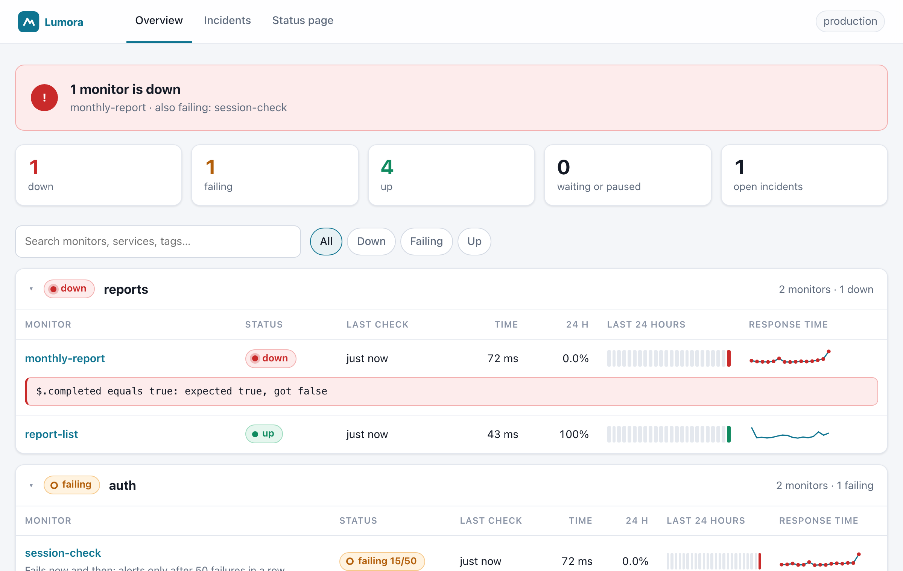

# Dashboard and REST API

`api-qovrix serve` also serves a dashboard and a REST API, in the same process as the scheduler.

```bash
api-qovrix serve --env-file .env      # password from .env (see below); http://localhost:8080
api-qovrix serve --port 9000          # another port
api-qovrix serve --no-web             # scheduler and alerts only, no dashboard
```

On your own machine you can skip the password: `api-qovrix serve` then serves an open dashboard on
`127.0.0.1` only.



## Pages

- **Overview:**
  - a banner with the overall state: green when all is up, amber when monitors are *failing* (failed, but
    not yet `alert_after` times in a row), red when monitors are *down*
  - one collapsible section per service: status badge, last check, response time, 24-hour uptime, a bar of
    the last 24 hours (one block per hour; hover for details) and a response-time sparkline
  - errors shown in a box under the monitor
  - search and filters (All / Down / Failing / Up), kept while the page updates itself every 15 seconds
- **Monitor:** the current error, 30-day uptime bar, response-time chart (failures marked), the last run's
  checks and drift diff, recent runs (click one to see its details), incidents, and a **Run now** button.
- **Incidents:** open and resolved incidents with how long they lasted.
- **Status page:** the public page, if enabled (see [status-page.md](status-page.md)).

Pages are rendered on the server, with no external scripts, fonts or CDNs, and work in light and dark mode
and on phones. Without JavaScript everything still shows, just without search and auto-update.

## Branding

```yaml
branding:
  name: Acme                    # replaces the project name in the header, login page and emails
  logo: branding/logo.svg       # .svg, .png, .jpg or .webp, up to 512 KB, relative to api-qovrix.yaml
  accent: "#0e7490"             # buttons, links and highlights
```

The same branding is used on the login page, the public status page and alert emails.

## Access and security

| Setting | Meaning |
|---|---|
| `--host` / `API_QOVRIX_HOST` | Address to listen on. Default `127.0.0.1` (this machine only). The Docker image uses `0.0.0.0`. |
| `--port` / `API_QOVRIX_PORT` | Port, default `8080`. |
| `API_QOVRIX_PASSWORD` | Dashboard login. **Required** (8+ characters) unless listening on `127.0.0.1` only. |
| `API_QOVRIX_API_KEY` | Key for the REST API (`Authorization: Bearer <key>`), for scripts and other tools. |

- Without a password the dashboard is open, which `serve` only allows on `127.0.0.1`. On any other address
  it refuses to start.
- Logins use a signed, `HttpOnly`, `SameSite=Lax` session cookie (marked `Secure` behind HTTPS) that lasts
  12 hours or until the process restarts. Wrong passwords are rate-limited per client.
- Every response has a strict Content-Security-Policy and anti-framing headers. Cross-site form posts are
  refused.
- For access over the internet, put it behind your existing reverse proxy with HTTPS (e.g. at
  `monitor.example.com`), or keep it private and reach it through a VPN or SSH tunnel.

## Setting the password safely

**1. Generate a strong one.** Use a random value, not a word or a reused password:

```bash
openssl rand -base64 24
# or: python3 -c "import secrets; print(secrets.token_urlsafe(24))"
```

Do the same for `API_QOVRIX_API_KEY` if scripts will use the REST API. Use two different values.

**2. Keep it in a file that is never committed**, readable only by you:

```bash
# .env  (next to api-qovrix.yaml)
API_QOVRIX_PASSWORD=paste-the-generated-value
API_QOVRIX_API_KEY=paste-another-generated-value
```

```bash
chmod 600 .env                 # only your user can read it
echo ".env" >> .gitignore      # never commit it
api-qovrix serve --env-file .env
```

The same file can hold your monitors' secrets (`API_TOKEN=...`) and notifier URLs. Values already set in the
environment take precedence over the file. `--host`, `--port` and `--data-dir` are read before the file is
loaded, so set those as options or real environment variables.

**3. Don't type it on the command line.** `API_QOVRIX_PASSWORD=... api-qovrix serve` works, but your shell
saves the line in its history file (`~/.zsh_history`, `~/.bash_history`), where the password stays in plain
text. If you already did this, change the password and remove the line from the history file.

**On a server**, use what the platform provides instead of a file next to the project:

| Where | How |
|---|---|
| Docker Compose | Put the variables in a `.env` file next to `docker-compose.yml` (Compose reads it automatically), `chmod 600` it, and keep it out of Git. See [`examples/docker-compose`](../examples/docker-compose/docker-compose.yml). |
| systemd | `EnvironmentFile=/etc/api-qovrix/api-qovrix.env` in the service, with that file owned by root and `chmod 600`. |
| Kubernetes | A Secret, mounted as environment variables. |
| Cloud platforms | Their secret manager or "environment variables / secrets" settings. |

**Changing it:** update the value and restart `serve`. Everyone is logged out, because sessions end when the
process restarts.

## REST API

All endpoints need `Authorization: Bearer $API_QOVRIX_API_KEY` (or a logged-in browser session), except
`/healthz`.

| Method | Path | Returns |
|---|---|---|
| GET | `/healthz` | `{"status": "ok", "last_check_at": ..., "monitors": ..., "version": ...}`; `503` when the scheduler isn't running. For load balancers, container health checks and outside uptime checks |
| GET | `/api/v1/services` | Services with their monitors and status, plus counts |
| GET | `/api/v1/monitors?service=` | Monitors with status, last result and 24 h uptime |
| GET | `/api/v1/monitors/{name}` | One monitor and its last 20 runs |
| GET | `/api/v1/monitors/{name}/runs?limit=` | Run history (newest first) |
| GET | `/api/v1/runs/{id}` | Full run details: steps, checks, drift changes (never response bodies) |
| POST | `/api/v1/monitors/{name}/run` | Run a monitor now; returns its status |
| GET | `/api/v1/incidents?state=open` | Incidents (`open` or all) |
| GET | `/api/v1/openapi.json` | OpenAPI description of this API |

```bash
curl -H "Authorization: Bearer $API_QOVRIX_API_KEY" https://monitor.example.com/api/v1/services
```

Example: run a check right after a deploy, from any CI or script:

```bash
curl -X POST -H "Authorization: Bearer $API_QOVRIX_API_KEY" \
  https://monitor.example.com/api/v1/monitors/checkout-flow/run
```
