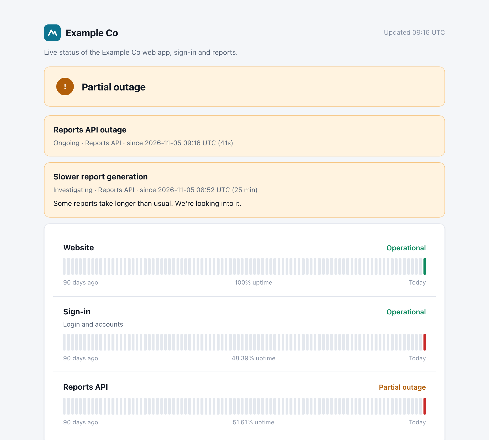

# Public status page

`api-qovrix serve` can publish a read-only status page for your users at `/status`, with no login. It shows
only what you choose: public service names, their current state, daily uptime and incident times. Monitor
names, URLs, error messages and drift details never appear on it.



## Turn it on

```yaml
# api-qovrix.yaml
branding:                       # used by the status page, the dashboard and alert emails
  name: Acme
  logo: branding/logo.svg       # a square icon; the name is shown next to it (.svg/.png/.jpg/.webp, ≤ 512 KB)
  accent: "#0e7490"

status_page:
  enabled: true
  title: Acme status            # default: "<branding.name> status"
  description: Live status of the Acme app, sign-in and reports.
  days: 90                      # uptime history to show (7-365)
  show_incidents: true          # list detected outages (times only)
  services:                     # which services are public, in this order
    - service: web              # the service name in your monitor files
      name: Website             # what your users see
    - service: auth
      name: Sign-in
      description: Login and accounts
    - service: reports
      name: Reports API
```

Services that aren't listed stay private. `api-qovrix validate` reports unknown services, a missing logo or a
bad color.

## What it shows

- **Overall state:** "All systems operational", "Partial outage", "Major outage" or "Scheduled maintenance
  in progress".
- **Per service:**
  - *Major outage* when all its monitors are down
  - *Partial outage* when some are down
  - *Maintenance* during a maintenance notice
  - otherwise *Operational*

  A monitor that is failing but not down yet (below its `alert_after`) doesn't change the public state, so
  one flaky check won't alarm your users.
- **Daily uptime bars** for the last `days` days. Hover a bar to see that day's uptime. Daily summaries are
  kept for 400 days, independent of `server.retention`.
- **Incidents:** outages api-qovrix detected (overlapping outages of one service are shown as one), plus your
  notices.

It refreshes itself every minute. `/status.json` returns the same data as JSON, for widgets or other
pages.

## Notices

Write notices in `api-qovrix.yaml`. They're kept in Git with your monitors, and `serve` reloads them
automatically when you save the file:

```yaml
status_page:
  notices:
    - title: Slower report generation
      message: Some reports take longer than usual. We're looking into it.
      status: investigating          # investigating | identified | monitoring | resolved | maintenance
      started: "2026-11-05T10:00:00Z"
      services: [reports]            # empty = all services
    - title: Database upgrade
      status: maintenance
      started: "2026-11-10T22:00:00Z"
      resolved: "2026-11-10T23:30:00Z"
```

- A notice appears once its `started` time has passed. Add `resolved` to move it to the history.
- Times need a time zone (`Z` for UTC, or e.g. `+08:00`).
- A `maintenance` notice that hasn't been resolved marks its services as *Maintenance*.

## Hosting it

The status page is served by the same process as the dashboard. A common setup:
- `https://monitor.example.com`: the dashboard, behind its password
- `https://status.example.com`: proxied to `/status` on the same `serve`

For example, in a reverse proxy, send `status.example.com/` to `http://127.0.0.1:8080/status` and allow only
`/status`, `/status.json`, `/static/`, `/brand.css` and `/brand/logo` on that hostname.
